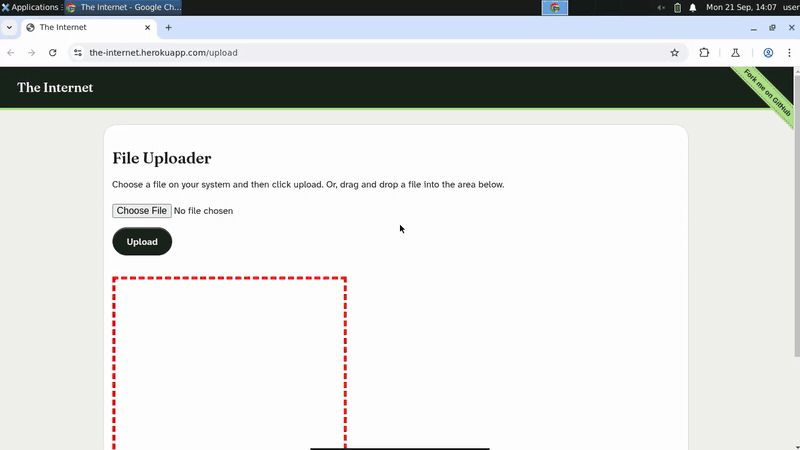

# A Playwright Alternative for Tests That Leave the Page


[](https://console.testdriver.ai/replay/6ae3210ef047d5fd1703521b?share=iOhZ7DRBIsS40p0V6f4PQ)

*Sped up: idle time removed. Click to watch the full replay with step-by-step logs.*

This repo is the complete, runnable example from the TestDriver tutorial **[A Playwright Alternative for Tests That Leave the Page](https://testdriver.ai/blog/playwright-alternative)**. The post walks through every line.

## What the test does

Create a file with exec(), click Choose File, pick the file in Chrome's real file picker dialog, click Upload, and assert the uploaded file name is shown. Before/after: Playwright's setInputFiles() (which skips the picker the user sees) next to the plain-language steps that drive the actual dialog.

It runs on a fresh cloud machine, installs the app the way a user would, and drives it from screenshots with plain-language steps. No selectors, test IDs or changes to the app.

## Run it

You need Node.js 20+ and a TestDriver API key (free to start at [console.testdriver.ai](https://console.testdriver.ai)).

```bash
git clone https://github.com/testdriverai/example-playwright-alternative.git
cd example-playwright-alternative
npm install
cp .env.example .env   # then paste your key into .env
npx vitest run
```

The run prints a link to its replay, so you can watch what happened.

## Run it in CI

[`.github/workflows/testdriver.yml`](.github/workflows/testdriver.yml) runs the test on every push and pull request using [`testdriverai/action`](https://github.com/testdriverai/action). Set up OIDC for your team, or add your key as a repository secret named `TD_API_KEY`. See [CI/CD](https://docs.testdriver.ai/ci-cd).

## Files

- [`tests/playwright-alternative.test.mjs`](tests/playwright-alternative.test.mjs): the test
- [`vitest.config.js`](vitest.config.js): Vitest with the TestDriver reporter
- [`.github/workflows/testdriver.yml`](.github/workflows/testdriver.yml): CI

## Learn more

- Tutorial: https://testdriver.ai/blog/playwright-alternative
- Docs: https://docs.testdriver.ai/quickstart
- More examples: https://docs.testdriver.ai
